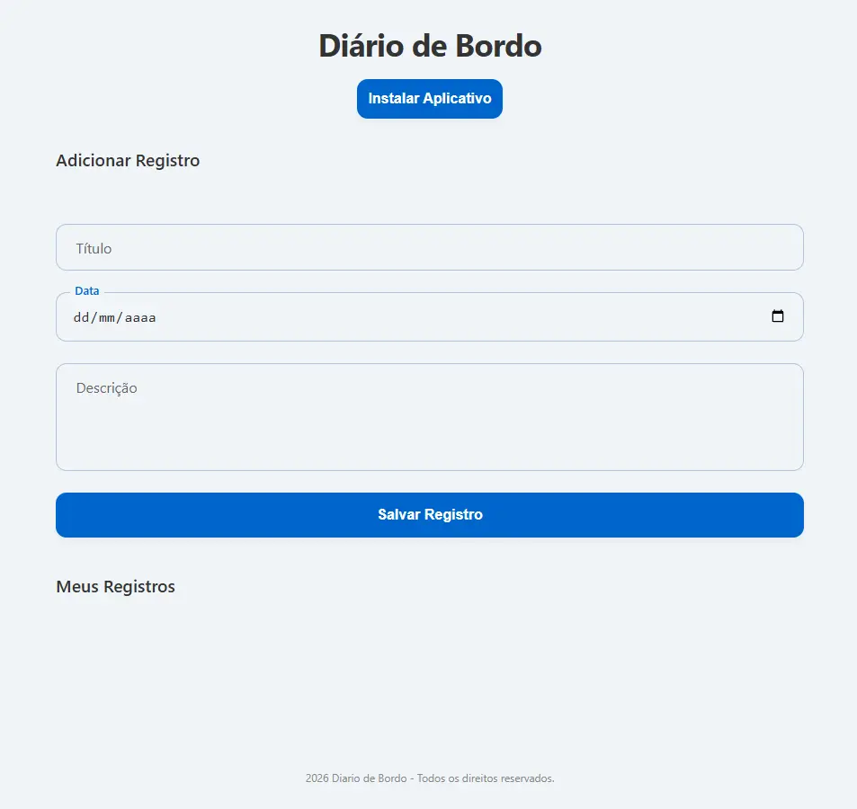

# Diário de Bordo

O Diário de Bordo é uma aplicação para registrar momentos e anotações pessoais. Cada registro reúne título, data e descrição, e fica disponível na lista para consulta ou exclusão. Os dados são armazenados no próprio navegador, permitindo usar o diário sem criar uma conta.

## Propósito

Este projeto foi desenvolvido como exercício prático de desenvolvimento front-end EBAC. A proposta é criar uma interface simples para adicionar e acompanhar registros, praticando manipulação do DOM com JavaScript, persistência local e recursos de Progressive Web App (PWA).

A aplicação também pode ser instalada em dispositivos compatíveis e utiliza um service worker para armazenar arquivos estáticos em cache e permitir o carregamento da interface quando a rede estiver indisponível.

## Tecnologias utilizadas

- HTML5
- CSS3, com layout responsivo
- JavaScript
- LocalStorage para persistência dos registros no navegador
- Web App Manifest para configuração de instalação
- Service Worker e Cache API para recursos offline

## Funcionalidades

- Criar registros com título, data e descrição.
- Listar registros salvos no navegador.
- Excluir registros individualmente.
- Validar o preenchimento dos campos obrigatórios.
- Manter os dados após fechar ou atualizar a página, por meio do LocalStorage.
- Instalar a aplicação como PWA em navegadores compatíveis.
- Armazenar os arquivos principais em cache com um service worker.
- Exibir layout adaptável a diferentes tamanhos de tela.

## Imagem do projeto

<p align="center">
    
</p>


## Deploy

[Acessar o Diário de Bordo](https://queirozvictor.github.io/Diario-de-Bordo/)

## Aprendizados

- Como estruturar uma página com HTML semântico e formulários.
- Como estilizar formulários, rótulos flutuantes e cartões com CSS.
- Como adaptar o layout para telas menores e maiores com media queries.
- Como capturar eventos de formulário e clique usando JavaScript.
- Como criar, exibir e excluir itens dinamicamente no DOM.
- Como persistir dados no navegador usando LocalStorage.
- Como configurar um Web App Manifest e registrar um service worker.
- Como usar a Cache API para disponibilizar arquivos estáticos da aplicação.

## Estrutura principal

```text
Diario-de-Bordo/
├── icons/
│   ├── icon-192x192.webp
│   └── icon-512x512.webp
├── index.html             # Estrutura da aplicação e formulário
├── manifest.json          # Configurações de instalação do PWA
├── script.js              # Registros, LocalStorage e instalação
├── service-worker.js      # Cache e suporte offline
└── style.css              # Estilos e layout responsivo
└── image/
    └── screenShot.webp    # Imagem do projeto em produção
```

## Executar localmente

Como o projeto usa service worker e recursos de PWA, execute-o em um servidor local. Com o VS Code, você pode abrir a pasta e iniciar um servidor pela extensão Live Server. Depois, acesse o endereço local fornecido pela extensão.

